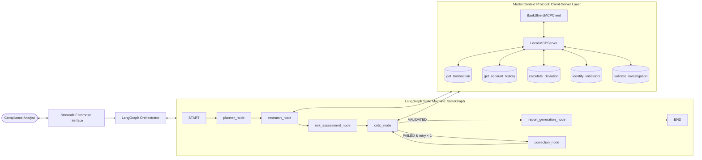

# BankShield AI: Multi-Agent Banking Risk Investigation (LangGraph & MCP Edition)

[](https://www.python.org/)
[](https://github.com/langchain-ai/langgraph)
[](https://modelcontextprotocol.io/)
[](https://streamlit.io/)
[](https://pytest.org/)
[](LICENSE)

> **Project Title:** BankShield AI: An Agentic AI System for Banking Transaction Risk Investigation and Decision Support  
> **Architecture Revision:** LangGraph State Machine Orchestration & Model Context Protocol (MCP) Tool Integration  
> **Domain:** Banking and Financial Services (FinTech Fraud Risk Operations)  

---

## 1. Executive Summary & Architecture Overview

In modern retail and commercial banking, transaction monitoring engines flag thousands of alerts daily. The subsequent investigation phase requires tedious record retrieval across disparate ledgers, baseline deviation calculations, and compliance documentation.

**BankShield AI** introduces an autonomous, explainable **Multi-Agent Decision Support System** revised with two industry-standard architectures:
1. **LangGraph StateGraph:** A typed state machine (`InvestigationState`) coordinating graph nodes for the Planner, Research, Risk Assessment, Critic, Self-Correction, and Reporting agents, featuring conditional routing and bounded retry limits.
2. **Model Context Protocol (MCP):** A local MCP server exposing standardized tools (`get_transaction`, `get_account_history`, `calculate_transaction_deviation`, `identify_transaction_indicators`, `validate_investigation`) invoked via an MCP client with schema validation and telemetry logging.



> ⚠️ **Disclaimer:** Operates on **100% synthetic demonstration data** with fictional accounts and merchants. High-risk indicators indicate anomalies requiring human inspection, **not** automated adverse action. No real financial credentials or PII are used.

---

## 2. Key LangGraph & MCP Capabilities

### A. LangGraph State Machine
- **Typed Shared State (`InvestigationState`):** TypedDict schema maintaining transaction metadata, 6-step roadmap, MCP tool call records, empirical indicator values, raw/normalized risk scores, Critic validation gates, and millisecond execution traces.
- **Conditional Routing:** If the Critic Agent flags a mathematical discrepancy or ungrounded conclusion, the graph routes execution to `correction_node` for calibrated recalculation.
- **Bounded Retry Limits:** Enforces `max_retries = 1`, preventing infinite execution loops and safely finalizing flagged dossiers if validation continues to fail.
- **100% Deterministic Operation:** Operates without requiring an external LLM or cloud API.

### B. Model Context Protocol (MCP) Tool Suite
- **Standardized MCP Server (`mcp_server/server.py`):** Built with official Python MCP SDK (`mcp.server.mcpserver.MCPServer`). Exposes 5 tools:
  1. `get_transaction`: Retrieves transaction amount, merchant, and channel details.
  2. `get_account_history`: Queries chronological records and historical profile baselines.
  3. `calculate_transaction_deviation`: Computes statistical mean, standard deviation, and amount $z$-score.
  4. `identify_transaction_indicators`: Evaluates empirical anomaly indicators (amount, velocity, unseen merchant, failed attempts, nocturnal hours).
  5. `validate_investigation`: Performs independent Critic mathematical recalculation and audit.
- **MCP Client (`services/mcp_client.py`):** Dispatches tool requests via MCP, enforces schema validation, handles connection exceptions, and records protocol telemetry (`MCP/2.0`).

### C. Deterministic Risk Engine
- **Transparent Scoring Capped at 100:**
  - Extreme Amount Deviation: **30 Points** ($z \ge 3.0$ or $> 5\times$ historical mean)
  - Velocity Burst Multiplier: **25 Points** ($> 3\times$ daily baseline)
  - Unseen Merchant Indicator: **20 Points** (Merchant not seen in account history)
  - Prior Failed Authorizations: **15 Points** ($\ge 3$ consecutive failures)
  - Nocturnal Execution Window: **10 Points** (Executed between 02:00 AM and 05:00 AM)
- **Standard Priority Tiers:** Low (0–29), Medium (30–59), High (60–79), Critical (80–100).
- **Human Decision Support:** Recommends specific analyst actions without branding transactions as "fraudulent".

---

## 3. Project Directory Structure

```text
bankshield-ai/
├── app.py                             # Main Streamlit application entrypoint & navigation
├── requirements.txt                   # Pinned dependency definitions
├── README.md                          # Comprehensive project documentation
├── LICENSE                            # MIT License
├── .gitignore                         # Git exclusion rules
│
├── config/
│   ├── __init__.py
│   └── settings.py                    # Configurable weights, thresholds, paths
│
├── data/
│   ├── .gitkeep
│   ├── transactions.csv               # 500 synthetic transactions (Fixed Seed: 42)
│   ├── account_profiles.csv           # 100 synthetic account profiles
│   ├── evaluation_results.json        # Output of benchmark evaluation runner
│   └── evaluation_results.csv         # Tabular benchmark metrics
│
├── mcp_server/
│   ├── __init__.py
│   └── server.py                      # Local Model Context Protocol (MCP) Server
│
├── orchestration/
│   ├── __init__.py
│   ├── investigation_state.py         # Typed Shared State schema for LangGraph
│   ├── langgraph_orchestrator.py      # LangGraph StateGraph, Nodes & Conditional Routing
│   └── orchestrator.py                # Legacy Orchestrator adapter
│
├── services/
│   ├── __init__.py
│   ├── data_service.py                # In-memory cached CSV data access service
│   ├── mcp_client.py                  # Standardized MCP Client & Telemetry Logger
│   ├── evaluation_service.py          # Benchmark scenario runner
│   └── llm_summary_service.py         # Optional Ollama integration with fallback
│
├── agents/
│   ├── __init__.py
│   ├── planner_agent.py               # Dynamic task roadmap generator
│   ├── research_agent.py              # Tool operator & evidence collector
│   ├── risk_assessment_agent.py       # Deterministic 5-rule scoring engine (0-100)
│   └── critic_agent.py                # 9-gate quality auditor & recalculator
│
├── tools/
│   ├── __init__.py
│   ├── transaction_tools.py           # Core Python data querying & anomaly functions
│   ├── risk_rules.py                  # Deterministic rule engine & models
│   └── report_tools.py                # 16-field dossier synthesis & export utilities
│
├── pages/
│   ├── 1_Executive_Overview.py        # Portfolio metrics & Plotly charts
│   ├── 2_Investigate_Transaction.py   # Investigation workbench & gauge chart
│   ├── 3_Agent_Workflow.py            # LangGraph StateGraph, MCP telemetry & state inspector
│   ├── 4_Investigation_Reports.py     # Filterable dossiers with JSON/CSV/TXT export
│   └── 5_Methodology.py               # Equations, evaluation tables & technical FAQ
│
├── scripts/
│   ├── __init__.py
│   ├── generate_data.py               # Deterministic synthetic data generator
│   ├── generate_diagrams.py           # Architecture & workflow diagram generator
│   └── evaluate.py                    # Standalone benchmark evaluation runner
│
├── tests/
│   ├── __init__.py
│   ├── test_langgraph.py              # LangGraph compilation, routing & retry tests (6 tests)
│   ├── test_mcp.py                    # MCP server tools, client & schema tests (9 tests)
│   ├── test_data_service.py           # Dataset schema and caching tests (8 tests)
│   ├── test_risk_rules.py             # Rule scoring, capping, and boundaries (5 tests)
│   ├── test_agents.py                 # Agent capabilities & tamper audit (7 tests)
│   ├── test_orchestrator.py           # Trace order, batching, and error handling (4 tests)
│   └── test_reports.py                # 16-field dossier and export tests (4 tests)
│
└── docs/
    ├── architecture.md                # System architecture & Mermaid sequence diagrams
    ├── methodology.md                 # Mathematical formulation & MCP specifications
    └── diagrams/                      # High-resolution architectural diagrams
```

---

## 4. Installation and Setup Instructions

### Prerequisites:
- Python 3.11, 3.12, or 3.13.
- Standard terminal (PowerShell, bash, or zsh).

### Step 1: Clone Repository and Navigate to Directory
```bash
git clone https://github.com/<your-username>/bankshield-ai.git
cd bankshield-ai
```

### Step 2: Install Dependencies
```bash
pip install -r requirements.txt
```

### Step 3: Run Full Automated Test Suite (43 Tests)
```bash
pytest tests/ -v
```
**Expected Output:** `43 passed in ~3.15s` (100% test pass rate across LangGraph, MCP, Agents, and Rules).

### Step 4: Run Benchmark Evaluation Suite
```bash
python scripts/evaluate.py
```
**Expected Output:** 6 of 6 benchmark scenarios passing with 100% scenario agreement and sub-second latency. Results saved to `data/evaluation_results.json` and `data/evaluation_results.csv`.

### Step 5: Start Streamlit Web Application
```bash
streamlit run app.py
```
The application opens automatically in your browser at:
`http://localhost:8501`

---

## 5. Demonstration Walkthrough

| Timing | Phase | Live Actions in Application |
|---|---|---|
| **Step 1** | **Executive Overview** | Open `app.py`. Review the banking investigation operational metrics: manual record lookup takes 10+ minutes per transaction; black-box ML models fail regulatory explainability. |
| **Step 2** | **LangGraph & MCP Architecture** | Navigate to `pages/3_Agent_Workflow.py`. Point out the compiled **LangGraph `StateGraph`** with explicit nodes (`planner_node`, `research_node`, `risk_assessment_node`, `critic_node`, `correction_node`, `report_generation_node`). Show the local **MCP Server tool suite**. |
| **Step 3** | **High-Risk Investigation** | Navigate to `pages/2_Investigate_Transaction.py`. Select preset `TXN-10198` and click **Run Multi-Agent Investigation**. Show the gauge chart (Score: 60/100, High Priority), the +30 pt amount deviation, and the LangGraph execution path badge. |
| **Step 4** | **MCP Telemetry & Critic Audit** | Expand **Technical Details & Critic 9-Gate Audit**. Show how the Research Agent executed 4 MCP tools (`get_transaction`, `get_account_history`, `calculate_deviation`, `identify_indicators`) and the Critic independently verified score equality (`score_matches: True`). |
| **Step 5** | **Validation & Error Handling** | In the transaction selector, pick `TXN-99999 (Error Scenario)`. Click Run. Show that the Planner and Research nodes handle non-existent records gracefully, the Critic flags validation failure, and the system terminates safely within bounded retry limits (`1/1`). |
| **Step 6** | **Reports & Dossier Export** | Open `pages/4_Investigation_Reports.py` to show persistent history. Download a dossier in JSON or formatted text. Conclude with `pages/5_Methodology.py` showing empirical evaluation results and system FAQ. |

---

## 6. Architecture & Technical Documentation

Technical documentation is located in `docs/`:
- **Architecture & Sequence Diagrams:** [`docs/architecture.md`](docs/architecture.md)
- **Methodology & Mathematical Formulation:** [`docs/methodology.md`](docs/methodology.md)
- **System Architecture Visuals:** [`docs/diagrams/`](docs/diagrams/)
- **License:** [MIT License](LICENSE)
