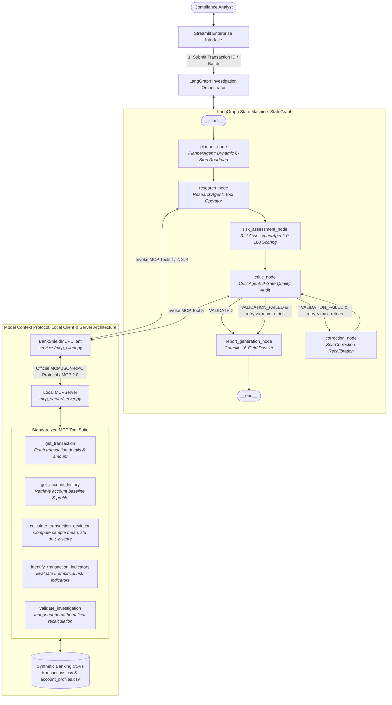
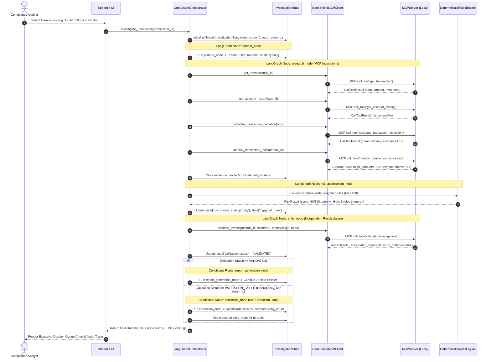

# BankShield AI: LangGraph and Model Context Protocol (MCP) Architecture

This document details the multi-agent system architecture for **BankShield AI**, featuring **LangGraph** for typed state machine orchestration and the **Model Context Protocol (MCP)** for standardized banking tool access.

---

## 1. System Architecture: LangGraph State Machine & MCP Server



---

## 2. Sequence Diagram: LangGraph State Transitions & MCP Tool Calls



---

## 3. LangGraph State Machine Specification

### Shared Typed State (`orchestration/investigation_state.py`)
All graph nodes communicate strictly via the typed `InvestigationState` schema:

```python
class InvestigationState(TypedDict, total=False):
    investigation_id: str
    transaction_id: str
    objective: str
    created_at: str

    # Planning
    plan: Dict[str, Any]
    current_step_index: int

    # Research & MCP Tool Output
    transaction_data: Optional[Dict[str, Any]]
    account_profile: Optional[Dict[str, Any]]
    account_history: List[Dict[str, Any]]
    deviation_analysis: Dict[str, Any]
    indicators: Dict[str, Any]
    evidence: Dict[str, Any]
    mcp_tool_calls: List[Dict[str, Any]]

    # Risk Assessment
    risk_result: Dict[str, Any]
    risk_score: int
    raw_score: int
    priority: str
    triggered_rules: List[Dict[str, Any]]
    recommendation: str

    # Critic & Validation
    validation_result: Dict[str, Any]
    validation_status: str  # 'VALIDATED', 'NEEDS_REVIEW', 'VALIDATION_FAILED'
    score_matches: bool
    recalculated_score: int
    recalculated_priority: str

    # Self-Correction Governance
    retry_count: int
    max_retries: int
    correction_applied: bool
    correction_history: List[Dict[str, Any]]

    # Final Dossier & Trace
    final_report: Dict[str, Any]
    status: str
    errors: List[str]
    node_history: List[str]
    execution_trace: List[Dict[str, Any]]
    total_duration_ms: float
```

### Graph Nodes and Responsibilities:
1. **`planner_node`:** Decomposes request into an ordered 6-step plan (`validate_input`, `retrieve_data`, `calculate_indicators`, `assess_risk`, `validate_results`, `generate_report`).
2. **`research_node`:** Connects to the local MCP server via `BankShieldMCPClient`. Executes `get_transaction`, `get_account_history`, `calculate_transaction_deviation`, and `identify_transaction_indicators`. Populates the evidence bundle and logs telemetry.
3. **`risk_assessment_node`:** Evaluates 5 deterministic rules with configurable weights (Amount: 30, Velocity: 25, Unseen Merchant: 20, Failed Authorizations: 15, Nocturnal Window: 10). Caps score at 100.
4. **`critic_node`:** Independently audits calculations using the Critic Agent and invokes the MCP tool `validate_investigation`. Sets `validation_status` to `VALIDATED` or `VALIDATION_FAILED`.
5. **`correction_node`:** Self-correction node entered only when validation fails. Adjusts score to the independently verified recalculation, logs a correction event, increments `retry_count`, and routes back to `critic_node`.
6. **`report_generation_node`:** Compiles the complete 16-field standardized dossier via `tools/report_tools.py`.

---

## 4. Model Context Protocol (MCP) Server & Client Specification

### Local Server Architecture (`mcp_server/server.py`)
Implemented using the official Python MCP SDK (`mcp.server.mcpserver.MCPServer`).

| Tool Name | Input Schema | Output Schema | Purpose |
|---|---|---|---|
| `get_transaction` | `transaction_id: string` (required) | `status: string, data: object` | Fetches transaction amount, timestamp, merchant, and channel from synthetic CSV. |
| `get_account_history` | `account_id: string` (required) | `status: string, record_count: int, profile: object, history: array` | Retrieves chronological records and profile baseline for account. |
| `calculate_transaction_deviation` | `transaction_id: string` (required) | `status: string, deviation: object (mean, std, z_score)` | Computes statistical spending deviation against historical mean. |
| `identify_transaction_indicators` | `transaction_id: string` (required) | `status: string, indicators: object` | Evaluates the 5 empirical risk indicators, separating missing data from absent risk. |
| `validate_investigation` | `transaction_id: string, reported_score: int, priority: string, triggered_rule_names: array` | `status: string, score_matches: bool, recalculated_score: int, checks: array` | Independent mathematical audit tool that recalculates scores and checks priority mapping. |

### MCP Client (`services/mcp_client.py`)
- Adheres to Model Context Protocol standards.
- Enforces argument schema validation before dispatch.
- Measures round-trip duration in milliseconds.
- Captures protocol logs with timestamps, argument payloads, and protocol versions (`MCP/2.0`).
- Recovers gracefully from tool errors and missing records.
